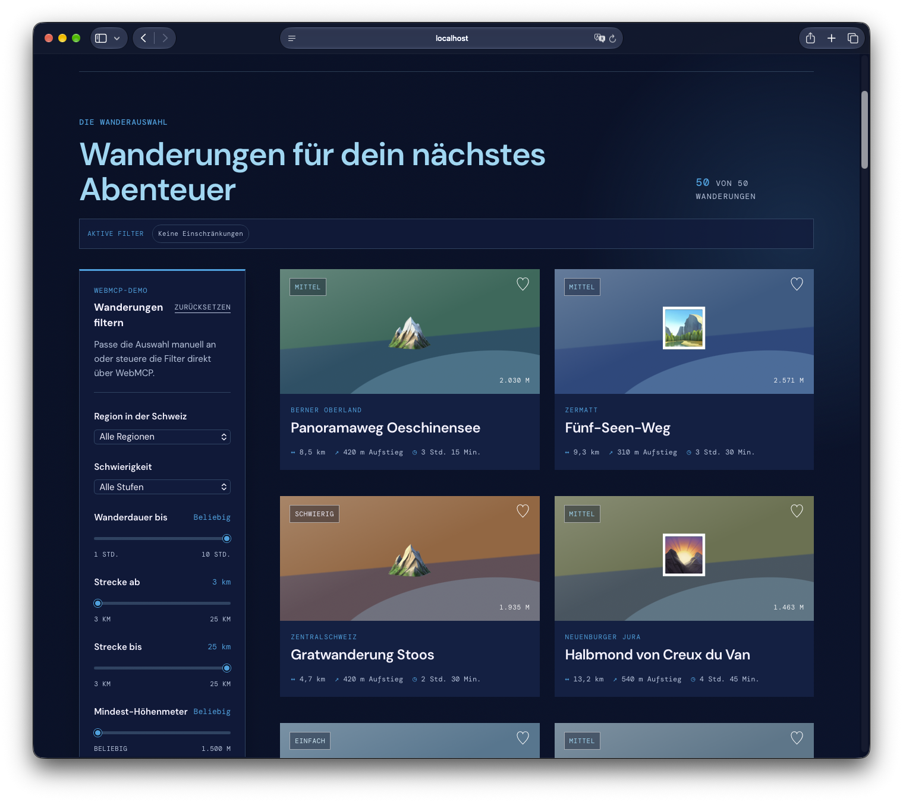
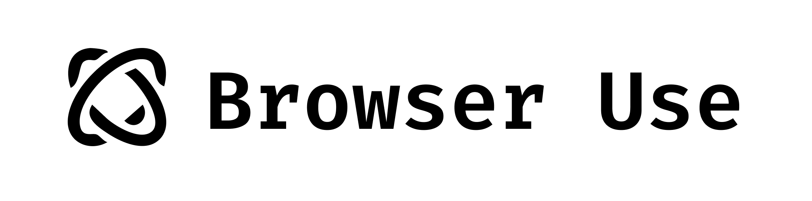
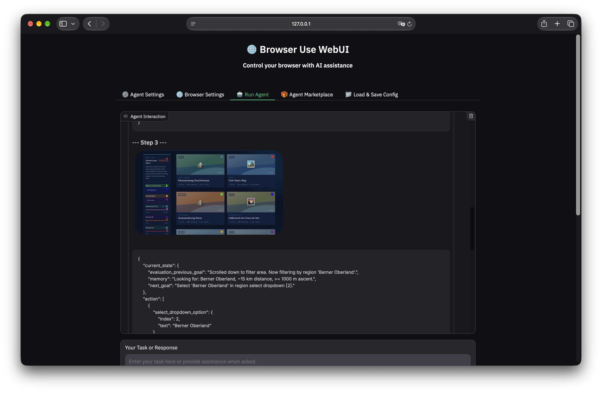
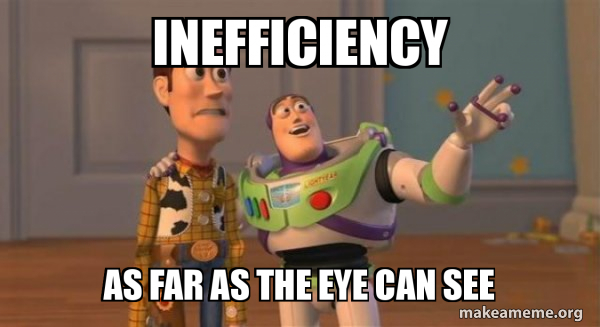

<div class="h-full flex flex-col items-center justify-center">
  <div class="text-sm tracking-widest uppercase opacity-60">
    WebMCP für KI-Agenten
  </div>

  <h1 class="!mt-6 !text-center !text-6xl font-sans tracking-tight">
    Der DOM ist<br><span class="text-primary">keine API</span>
  </h1>

  <div class="mt-12 text-xl opacity-70">
    DevCon Lozärn · 23. Oktober 2026
  </div>
</div>

<!--
Kurzer Einstieg mit Titel und Thema.

Timing: 0:00-0:20
-->

---
layout: center
class: text-left
transition: slide-up
---

<HikeRequest />

<!--
Der Hook ist ein konkreter Nutzerwunsch. Für Menschen ist die Absicht klar;
Software muss sie erst in die Bedienung einer Seite übersetzen.

Timing: 0:20-1:00
-->

---
layout: two-cols-header
layoutClass: gap-10
transition: slide-left
---

# Trailfolk

::left::

<div class="mt-6 text-left text-xl leading-relaxed">

Eine kleine Schweizer Wander-App.

- Filter: Region, Schwierigkeit, Distanz, Dauer, Höhenmeter
- Resultatliste mit Wanderkarten

</div>

::right::

<div class="mt-4">
  <a href="http://localhost:4040" target="_blank" rel="noopener noreferrer">
    
  </a>
</div>

<!--
Trailfolk kurz aus Sicht eines Menschen vorstellen: Filter setzen, Resultate
sehen, eine Wanderung öffnen. Nur so viel zeigen, dass die App verständlich ist.

Demo 1: Den Wunsch aus der Sprechblase manuell umsetzen. Mit demselben
Ausgangszustand und denselben Kriterien wie in den beiden Agenten-Demos starten.

Der Screenshot öffnet auf Klick die lokale Trailfolk-App.

Timing: 1:00-3:00
-->

---
layout: center
class: text-left
transition: fade
---


<div class="text-5xl leading-relaxed mt-6">
Wie gehen <span class="text-primary font-bold">Web Agents</span> hier vor?
</div>

<div class="mt-6 text-lg opacity-70">
Web Agents lesen und bedienen Websites im Browser - im Auftrag eines Nutzers.
</div>

<div v-click class="mt-30">
  <div class="grid grid-cols-3 gap-5 mt-3">
    <div class="rounded-xl border border-primary/30 bg-white p-5">
      
    </div>
    <div class="rounded-xl border border-primary/30 bg-white p-5">
      
    </div>
    <div class="rounded-xl border border-primary/30 bg-white p-5">
      
    </div>
  </div>
</div>

<!--
Nach der Trailfolk-Einordnung folgt die Leitfrage: Wie setzt ein Web Agent den
Nutzerwunsch heute um? Browser Use, Skyvern und Stagehand zeigen: Dafür gibt es
bereits mehrere Angebote. Die nächste Folie beantwortet das Vorgehen Schritt
für Schritt.

Timing: 3:00-4:30
-->

---
layout: two-cols-header
layoutClass: gap-10
transition: slide-left
---

# Wie ein Agent das heute macht

::left::

<div class="mt-6 text-left text-lg leading-loose">

<div v-click>1. Screenshot und DOM lesen</div>
<div v-click>2. Accessibility-Tree auswerten</div>
<div v-click>3. Passende Controls raten (IDs, Labels)</div>
<div v-click>4. Klicken, tippen, warten</div>
<div v-click>5. Den neuen Zustand erneut auslesen</div>
<div v-click>6. Zurück zu Schritt 1</div>

</div>

::right::

<div class="mt-4">
  <a href="http://127.0.0.1:7788/?__theme=dark" target="_blank" rel="noopener noreferrer">
    
  </a>
</div>


<!--
Nicht "Agents scrapen nur". Moderne Agents nutzen mehrere Signale. Der Punkt:
Bedeutung wird aus einer für Menschen gebauten Oberfläche rekonstruiert - Schritt
für Schritt, jedes Mal neu.

Demo 2: Denselben Wunsch ohne WebMCP ausführen lassen. Ein erfolgreicher
Durchlauf ist erwünscht; der sichtbare Interaktionsaufwand ist der Vergleich,
nicht ein provozierter Fehler.

Timing: 4:30-5:30
-->

---
layout: two-cols
layoutClass: gap-10
transition: fade
---

<h1>Das funktioniert</h1>

<div class="mt-8 text-left text-xl leading-relaxed">

  <ul class="list-disc pl-6">
    <li>Braucht keine Integration seitens der Seite</li>
    <li>Funktioniert auch bei alten Seiten</li>
    <li>Nutzt vorhandene Semantik und Accessibility</li>
  </ul>

</div>

::right::

<h1 v-click="1">Aber ...</h1>

<div v-click="1" class="mt-8 text-left text-xl leading-relaxed">

  <ul class="list-disc pl-6">
    <li>Viele Schritte für eine einfache Absicht</li>
    <li>Zustand nach jeder Aktion neu lesen</li>
    <li>Mehrdeutige Controls, Fehlklicks</li>
    <li>Bedeutung wird geraten, nicht gegeben</li>
  </ul>

</div>

<div v-click="2" class="absolute inset-0 z-10 flex items-center justify-center bg-slate-900/20 px-12 backdrop-blur-sm">
  <div class="flex flex-col items-center">
    <a
      href="https://makeameme.org/meme/inefficiency-inefficiency"
      target="_blank"
      rel="noopener noreferrer"
    >
      
    </a>
    <a
      href="https://makeameme.org/meme/inefficiency-inefficiency"
      target="_blank"
      rel="noopener noreferrer"
      class="mt-3 text-xs opacity-40 hover:opacity-70"
    >
      makeameme.org/meme/inefficiency-inefficiency
    </a>
  </div>
</div>


<!--
UI-Automation bricht nicht einfach. Sie ist ein Umweg: ineffizient und ungenau.
Wichtig für dieses Publikum: WebMCP ist kein Argument gegen Accessibility.
Zugängliche Seiten helfen weiterhin Menschen und UI-basierten Agents.

Timing: 5:30-6:30
-->

---
layout: center
class: text-left
transition: slide-up
---

<div class="text-5xl leading-relaxed">
Was, wenn die Webseite ihre Fähigkeiten
<span class="text-primary font-bold">selbst beschreibt</span> -
statt sie erraten zu lassen?
</div>

<!--
Der Übergang. Kurz und ohne Definition. Die Frage öffnet WebMCP.

Timing: 6:30-7:00
-->

---
layout: default
class: text-left
transition: slide-left
---

# WebMCP - Web Model Context Protocol

<div class="mt-12 text-3xl leading-relaxed">
Ein Vorschlag für einen Webstandard, mit dem
<span class="text-primary font-bold">Websites strukturierte Tools für KI-Agenten</span> bereitstellen können.
</div>

<div v-click class="mt-12 text-2xl leading-relaxed">
Jede Aktion ist ein <span class="font-bold text-primary">Tool</span>: Name, Beschreibung, Eingaben.
</div>

<div class="absolute bottom-6 right-8 text-sm opacity-60">
  <a href="https://webmachinelearning.github.io/webmcp/" target="_blank" rel="noopener noreferrer">Vorschlag der W3C Web Machine Learning Community Group (Google und Microsoft).</a>
</div>

<!--
WebMCP steht für Web Model Context Protocol. Der Vorschlag wird von Ingenieuren
von Google und Microsoft in der W3C Web Machine Learning Community Group
entwickelt; er ist noch kein verabschiedeter Standard. Kern: Die Website
benennt die erlaubten Aktionen und ihre Eingaben. Dadurch muss der Agent
nicht aus der Oberfläche rekonstruieren, welche Klicks nötig wären.
Die konkrete Tool-Registrierung mit JavaScript kommt später.

Timing: 7:00-8:00
-->

---
layout: default
transition: fade
---

# WebMCP in Trailfolk

<HikeRequest compact class="mt-10" />

<div class="mt-10 text-center">
  <a href="http://localhost:4040" target="_blank" rel="noopener noreferrer"
    class="inline-flex items-center gap-3 rounded-xl bg-primary px-8 py-3 text-xl font-bold text-[#061126] shadow-lg shadow-primary/20 transition hover:bg-[#8dd9f3] focus-visible:outline focus-visible:outline-2 focus-visible:outline-offset-4 focus-visible:outline-primary">
    Demo <span aria-hidden="true">↗</span>
  </a>
</div>

<!--
Jetzt direkt auf der Website zeigen, wie Trailfolk dem Agenten die passende
Aktion anbietet und wie sich das Ergebnis in der Seite zeigt.

Demo 3: Tool-Angebot, übergebene Parameter, Rückgabe und aktualisierte UI zeigen.
In DevTools unter Application > WebMCP die verfügbaren Tools und den
tatsächlichen Aufruf öffnen. Ein manuell gestarteter Aufruf testet die
Tool-Ausführung, nicht die Auswahl durch das Modell; diesen Unterschied benennen.
App, Agent und DevTools nacheinander gross zeigen, nicht alles klein nebeneinander.
Eine vorbereitete Aufnahme als Backup bereithalten.

Timing: 8:00-10:30
-->

---
layout: default
transition: slide-left
---

<div class="text-sm tracking-widest uppercase opacity-55">Under the hood</div>

# Wie funktioniert WebMCP?

<div class="flex items-start justify-center gap-2 mt-6 text-center text-sm">
  <div class="flex-1 h-20 flex flex-col justify-center rounded-xl border border-main/25 p-3">
    <div class="font-bold">🧑 Nutzer</div>
    <div class="opacity-70 mt-1">Wunsch in natürlicher Sprache</div>
  </div>
  <div class="h-20 flex items-center text-primary text-2xl">→</div>
  <div class="flex-1 flex flex-col items-center gap-1">
    <div class="w-full h-20 flex flex-col justify-center rounded-xl border border-main/25 p-3">
      <div class="font-bold">🤖 Browser-Agent</div>
      <div class="opacity-70 mt-1">wählt passendes Tool</div>
    </div>
    <div class="text-amber-400 text-lg leading-none">↕</div>
    <div class="w-full rounded-xl border-2 border-amber-400 bg-amber-400/10 p-2 text-xs">
      <div class="font-bold text-amber-400">KI-Plattform · LLM</div>
      <div class="opacity-80">meist remote · ggf. Token-Kosten</div>
    </div>
  </div>
  <div class="h-20 flex items-center text-primary text-2xl">→</div>
  <div class="flex-[1.3] h-20 flex flex-col justify-center rounded-xl border-2 border-primary bg-primary/10 p-3">
    <div class="font-bold text-primary">Web-App · eigene Tools</div>
    <div class="opacity-80 mt-1">Seiten-Code, kein zusätzliches Modell</div>
  </div>
  <div class="h-20 flex items-center text-primary text-2xl">→</div>
  <div class="flex-1 h-20 flex flex-col justify-center rounded-xl border border-main/25 p-3">
    <div class="font-bold">Backend</div>
    <div class="opacity-70 mt-1">bestehende API (optional)</div>
  </div>
</div>

<div class="text-center mt-4 text-sm leading-relaxed">
  Das <span class="text-amber-400 font-bold">Modell interpretiert den Wunsch</span> - die
  <span class="text-primary font-bold">Tools führen den Code aus</span>.
</div>

<div class="grid grid-cols-2 gap-6 mt-8 text-left text-lg leading-snug">
  <div v-click class="rounded-xl border border-primary/30 bg-primary/5 p-5">
    <div class="font-bold text-primary text-xl">Kein zusätzlicher Tool-Server</div>
    <div class="mt-2">Tools laufen in der Web-App und können bestehende Backend-APIs nutzen.</div>
  </div>
  <div v-click class="rounded-xl border border-primary/30 bg-primary/5 p-5">
    <div class="font-bold text-primary text-xl">Session &amp; Kontext nutzen</div>
    <div class="mt-2">Login-, UI- und Anwendungszustand der laufenden Seite stehen zur Verfügung.</div>
  </div>
</div>

<!--
Wichtig: als typische Architektur präsentieren, nicht als zwingenden Ablauf jeder
WebMCP-Implementierung. WebMCP ist derzeit noch ein vorgeschlagener Webstandard.
Das Modell interpretiert den Wunsch (meist remote, ggf. Kosten); die Tools führen
Seiten-Code im Kontext der Webseite aus.

Auf der Tonspur einschränken: Der Agent muss weiterhin das passende Tool und
die richtigen Parameter wählen. WebMCP beseitigt die UI-Übersetzung, nicht jede
mögliche Fehlentscheidung.

Timing: 11:30-12:30
-->


---
layout: default
transition: slide-up
---


# Was geht heute?

<div class="grid grid-cols-2 gap-8 mt-6 text-left text-lg leading-relaxed">
  <div class="rounded-xl border border-main/20 p-5">
    <h2>Browser-API</h2>
    <p class="mt-3">Chrome &amp; Edge: experimentell über <span class="whitespace-nowrap font-bold text-primary">Origin Trials</span>.</p>
    <p class="mt-3 text-base opacity-75">Lokal testen: Flag<br><code>#enable-webmcp-testing</code></p>
  </div>
  <div class="rounded-xl border border-main/20 p-5">
    <h2>Agent-Unterstützung</h2>
    <p class="mt-3">ChatGPT Desktop: <span class="font-bold text-primary">Site Tools</span> im integrierten Browser.</p>
    <p class="mt-3 text-base opacity-75">Bei anderen Agenten separat prüfen.</p>
  </div>
</div>

<div class="absolute bottom-6 right-8 text-sm opacity-60">
  Aktueller Stand: <a href="https://webmcp.com/ecosystem-tracker" target="_blank" rel="noopener noreferrer">webmcp.com/ecosystem-tracker</a>
</div>

<!--
Praktischer Einstieg statt einer Übersicht der Browsing-Varianten:
Chrome ab 149 und Edge ab 150 mit Origin Trials; lokal über
chrome://flags/#enable-webmcp-testing bzw. edge://flags/#enable-webmcp-testing.
Ein Origin Trial erfordert die Registrierung der Website; das lokale Flag
ist für die Entwicklung gedacht. Beides ersetzt keinen passenden Agenten.

ChatGPT Desktop unterstützt Site Tools laut OpenAI im integrierten Browser.
Verfügbarkeit hängt von Konto und ausgewähltem Modell ab. Dieser Browser hat
seinen eigenen Zustand; ein Chrome-Login wird nicht automatisch übernommen.

Mozilla ist neutral, WebKit ablehnend: Es gibt noch keinen browserübergreifenden
Konsens. Positionen und Verfügbarkeit vor dem Vortrag erneut prüfen.
Primärquellen: Implementierungsstand im WebMCP-Repository, OpenAI Site Tools,
https://github.com/mozilla/standards-positions/issues/1412 und
https://github.com/WebKit/standards-positions/issues/670.

Timing: 10:30-11:30
-->

---
layout: default
transition: fade
---

<div class="text-sm tracking-widest uppercase opacity-55">Vertrag · Verhalten · Verantwortung</div>

# Schema, Annotations &amp; Ownership

<div class="text-base opacity-70 -mt-1 mb-4">Drei Themen, die jedes WebMCP-Tool adressieren sollte</div>

<div class="grid grid-cols-3 gap-5 text-left text-base leading-snug">

  <div v-click class="rounded-xl border border-primary/30 bg-primary/5 p-5 flex flex-col">
    <div class="text-xs uppercase tracking-wider text-primary/70">1 · Vertrag</div>
    <div class="font-bold text-primary text-2xl mt-1">Schema</div>
    <div class="mt-2 opacity-80">Welche Eingaben akzeptiert das Tool?</div>
    <div class="mt-auto pt-6 text-sm opacity-70"><code>region</code> nur aus Liste<br><code>maxDistanceKm</code> als Zahl</div>
  </div>

  <div v-click class="rounded-xl border border-primary/30 bg-primary/5 p-5 flex flex-col">
    <div class="text-xs uppercase tracking-wider text-primary/70">2 · Verhalten</div>
    <div class="font-bold text-primary text-2xl mt-1">Annotations</div>
    <div class="mt-2 opacity-80">Wie ist das Tool einzuordnen?</div>
    <div class="mt-auto pt-6 text-sm opacity-70">
      <code>readOnlyHint</code><br>
      <code>consequentialHint</code><br>
      <code>untrustedContentHint</code>
    </div>
  </div>

  <div v-click class="rounded-xl border border-primary/30 bg-primary/5 p-5 flex flex-col">
    <div class="text-xs uppercase tracking-wider text-primary/70">3 · Verantwortung</div>
    <div class="font-bold text-primary text-2xl mt-1">Ownership</div>
    <div class="mt-2 opacity-80">Wer kontrolliert die Ausführung?</div>
    <div class="mt-auto pt-6 text-sm opacity-70">Die Web-App: Login, Berechtigungen, Fachregeln</div>
  </div>

</div>

<!--
Mentales Modell vor dem Code in drei Schritten: Erst Vertrag (Schema - was
akzeptiert das Tool), dann Verhalten (Annotations - wie ist es einzuordnen),
dann Verantwortung (Ownership - wer prüft Berechtigungen und autorisiert
Aktionen). Die drei Perspektiven erklären, nicht jede Annotation einzeln
vertiefen.

Danach zeigen die nächsten zwei Folien, wie dieses Modell zuerst als API-Wahl
und dann in Trailfolk-Code aussieht.

Fachliche Präzisierung: consequentialHint ist ein Hinweis auf potenziell
folgenreiche Aktionen - keine Garantie, dass der Browser eine Bestätigung
erzwingt. Ebenso ersetzt untrustedContentHint keine tatsächliche Sanitization;
solche Schutzmaßnahmen müssen explizit implementiert werden. Ownership heißt
nicht nur: wem gehört der Code, sondern auch: wer prüft Login, Berechtigungen
und fachliche Regeln.

Timing: 11:30-13:00
-->

---
layout: default
class: tools-api-slide
transition: slide-up
---

<div class="text-sm tracking-widest uppercase opacity-55">Der Code</div>

# Imperativ oder deklarativ

<div class="grid grid-cols-2 gap-8 mt-8 text-left">
  <div v-click="1" class="rounded-xl border border-primary/30 bg-primary/5 p-6">
    <div class="text-primary font-bold text-xl">Imperativ (JS)</div>
    <code class="block mt-4 text-sm">document.modelContext<br>.registerTool({ … })</code>
    <div class="mt-5 text-lg">Für eigene Logik, Navigation, Zustand, komplexe Abläufe.</div>
  </div>
  <div v-click="2" class="rounded-xl border border-primary/30 bg-primary/5 p-6 transition-opacity duration-300" :style="{ opacity: $clicks >= 3 ? 0.4 : undefined }">
    <div class="text-primary font-bold text-xl">Deklarativ (HTML)</div>
    <code class="block mt-4 text-sm">&lt;form toolname="…"<br>tooldescription="…"&gt;</code>
    <div class="mt-5 text-lg">Für bestehende Formulare - der Browser leitet Tool und Schema ab.</div>
  </div>
  <div v-click="3" class="col-start-2 text-base leading-relaxed">
    <span class="font-bold text-primary">Aktuell weniger im Fokus:</span>
    Die deklarative API wird <a href="https://github.com/webmachinelearning/webmcp#future-exploration-declarative-api" target="_blank" rel="noopener noreferrer">separat erforscht</a>
    und ist derzeit nicht mehr Teil des Spezifikationsentwurfs.
  </div>
</div>

<!--
Überblick vor dem konkreten Code: Beide APIs setzen das eben vorgestellte
Modell um. Imperativ für zustandsbehaftete Apps wie Trailfolk, deklarativ für
vorhandene HTML-Formulare.

Klick 1: JavaScript zeigen. Klick 2: HTML zeigen. Klick 3: HTML abblenden
und den aktuellen Spezifikationsfokus einordnen. Die deklarative API wird
separat erforscht; Chrome dokumentiert und erprobt sie weiterhin. Das ist keine
Zusage, dass sie später Teil des Standards wird.

Timing: 13:00-14:00
-->

---
layout: default
transition: fade
---

<div class="text-sm tracking-widest uppercase opacity-55">Imperativ · JavaScript</div>

# <i>filter_hikes</i>&nbsp;&nbsp;&nbsp;als Tool

```js {all|1|2|3|4-14|15-18}
await document.modelContext.registerTool({
  name: 'filter_hikes',
  description: 'Filtert Wanderungen nach Region, Schwierigkeit, Distanz, Dauer und Höhenmetern.',
  inputSchema: {
    type: 'object',
    properties: {
      region: { type: 'string', enum: ['zentralschweiz', 'tessin', 'berner-oberland'] },
      difficulty: { type: 'string', enum: ['leicht', 'mittel', 'schwer'] },
      maxDistanceKm: { type: 'number', description: 'Maximale Distanz in km' },
      maxDurationH: { type: 'number', description: 'Maximale Gehzeit in Stunden' },
      minElevation: { type: 'number', description: 'Minimale Höhenmeter' },
    },
    required: ['region'],
  },
  execute: async (args) => {
    const hikes = applyFilters(args)
    return `${hikes.length} Wanderungen gefunden.`
  },
})
```

<!--
Der Kern für Entwickler: Name, Description, inputSchema (Vertrag), execute.
Damit wird das abstrakte Modell konkret: inputSchema beschreibt den Vertrag;
die Web-App bleibt für Authentisierung, Berechtigungen und Fachregeln
verantwortlich. execute ruft dieselbe Logik wie die UI auf. Das Tool ändert den
UI-Zustand und ist deshalb nicht read-only.

Timing: 14:00-15:30
-->

---
layout: default
transition: slide-up
---

<div class="text-sm tracking-widest uppercase opacity-55">Aber es gibt doch MCP?</div>

# MCP und WebMCP

<div class="mt-6 text-left text-lg">

| | MCP / OpenAPI im Backend | WebMCP im Browser |
|---|---|---|
| Tool läuft bei | Service oder API | laufender Web-App |
| Gut für | Server- und System-Workflows | UI-, Session- und Kontext-Workflows |
| Beispiel | Zahlung auslösen, Daten abfragen | Filter setzen, Formular ausfüllen |

</div>

<div v-click class="mt-6 rounded-xl border border-primary/30 bg-primary/10 p-4 text-xl text-left">
WebMCP ersetzt kein Backend-MCP.<br/>Es ergänzt es dort, wo der Browser-Kontext Teil der Aufgabe ist.
</div>

<!--
Häufige Frage: Unterschied zu MCP? Kein Entweder-oder. Serverseitige Operationen
→ MCP/OpenAPI. Wenn die geöffnete Seite, ihr Zustand und die Nutzerkontrolle
zählen → WebMCP.

Timing: 17:30-18:30
-->

---
layout: center
class: text-left
transition: slide-left
---

# WebMCP: 3 Dinge zum Mitnehmen

<div class="mt-10 space-y-6 text-2xl leading-relaxed">
  <div v-click class="grid grid-cols-[2rem_1fr] gap-x-3 items-start">
    <span class="text-primary font-bold">1.</span>
    <span>WebMCP macht <span class="text-primary font-bold">Web-Fähigkeiten explizit</span>, statt sie zu erraten.</span>
  </div>

  <div v-click class="grid grid-cols-[2rem_1fr] gap-x-3 items-start">
    <span class="text-primary font-bold">2.</span>
    <span>Es <span class="text-primary font-bold">ergänzt</span> Backend-MCP, APIs und Accessibility - es ersetzt sie nicht.</span>
  </div>

  <div v-click class="grid grid-cols-[2rem_1fr] gap-x-3 items-start">
    <span class="text-primary font-bold">3.</span>
    <span>Der Nutzen hängt am <span class="text-primary font-bold">Tool-Design</span>.</span>
  </div>
</div>

<!--
Drei Kernaussagen zum Mitnehmen.

Beim dritten Punkt die Design-Frage mündlich anschliessen:
"Welche Funktion eurer Web-App würdet ihr einem Agenten als Tool anbieten?"
Keine Prognose versprechen: Auch wenn WebMCP experimentell ist, hilft diese
Frage schon heute beim Tool-Design. Danach direkt zum Rückgriff auf den Einstieg.

Timing: 18:30-19:30
-->

---
layout: center
class: text-left
transition: slide-up
---

<HikeRequest compact />

<div v-click class="mt-6 grid grid-cols-[8rem_1fr] gap-x-5 gap-y-2 text-xl leading-snug">
  <span class="opacity-60">Vorher</span>
  <span class="opacity-80">UI lesen, Controls finden, klicken.</span>
  <span class="font-bold text-[#8dd9f3]">WebMCP</span>
  <span>Passendes Tool direkt aufrufen.</span>
</div>

<div v-click class="mt-6 text-4xl font-b
  <div>Der DOM ist keine API.</div>
</div>

<div v-click class="mt-6 text-4xl font-bold leading-tight">
  <div class="mt-3 text-[#8dd9f3]">Dank WebMCP können Web-Apps eine anbieten.</div>
</div>

<!--
Bogen zurück zum Hook: derselbe Nutzerwunsch wie am Anfang.
Zuerst den kurzen Vergleich einblenden: UI bedienen versus Tool aufrufen.
"Derselbe Wunsch wie am Anfang. Aber der Agent muss nicht mehr die Bedienung
erraten - die Web-App bietet ihm das passende Tool an."
Danach die beiden Schlussaussagen gemeinsam einblenden: Titel und Antwort.

Timing: 19:30-19:50
-->

---
layout: center
class: text-center
transition: fade
---

<div class="text-6xl font-bold text-center">
  Danke - Fragen?
</div>

<div class="mt-14 text-center text-lg leading-relaxed">
  <div class="font-bold text-primary">Markus Tanner</div>
  <div>Software Engineer</div>
  <a href="mailto:markus.tanner@css.ch">markus.tanner@css.ch</a>
</div>

<!--
Danke und Übergang zu den 5 Minuten Fragen. Bei Bedarf auf Demo, Tool-Design,
Security oder Spezifikationsstand eingehen.

Timing: 19:50-20:00 (+ 5 min Q&A)
-->

---
layout: default
transition: fade
---

# Quellen

<div class="grid grid-cols-2 gap-10 mt-8 text-lg leading-relaxed">
  <div>
    <h2>Spezifikation &amp; Praxis</h2>
    <ul class="mt-4 space-y-3 list-disc pl-5">
      <li><a href="https://webmachinelearning.github.io/webmcp/" target="_blank" rel="noopener noreferrer">WebMCP-Spezifikationsentwurf</a></li>
      <li><a href="https://developer.chrome.com/docs/ai/webmcp" target="_blank" rel="noopener noreferrer">Chrome: Einstieg &amp; APIs</a></li>
      <li><a href="https://developer.chrome.com/docs/devtools/application/webmcp" target="_blank" rel="noopener noreferrer">Chrome DevTools: WebMCP</a></li>
      <li><a href="https://webmcp.com" target="_blank" rel="noopener noreferrer">webmcp.com: Überblick &amp; Ressourcen</a></li>
      <li><a href="https://github.com/browser-use/web-ui" target="_blank" rel="noopener noreferrer">Browser Use Web UI</a></li>
    </ul>
  </div>
  <div>
    <h2>Unterstützung &amp; Positionen</h2>
    <ul class="mt-4 space-y-3 list-disc pl-5">
      <li><a href="https://github.com/webmachinelearning/webmcp/blob/main/implementation-status.md" target="_blank" rel="noopener noreferrer">WebMCP: Implementierungsstand</a></li>
      <li><a href="https://help.openai.com/en/articles/20001423-using-site-tools-in-the-chatgpt-desktop-app" target="_blank" rel="noopener noreferrer">OpenAI: Site Tools</a></li>
      <li><a href="https://github.com/mozilla/standards-positions/issues/1412" target="_blank" rel="noopener noreferrer">Mozilla: neutrale Position</a></li>
      <li><a href="https://github.com/WebKit/standards-positions/issues/670" target="_blank" rel="noopener noreferrer">WebKit: ablehnende Position</a></li>
    </ul>
  </div>
</div>

<!--
Backup-Folie für die Fragerunde, nicht Teil der 20 Minuten.
-->
